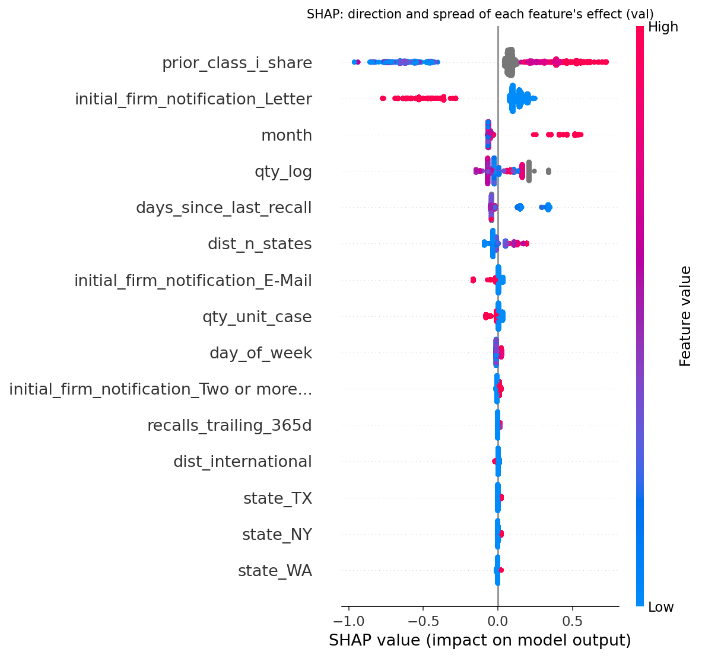
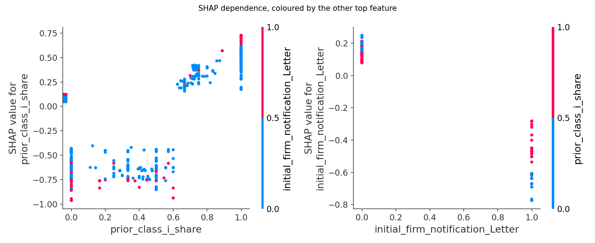

# Predicting FDA Class I Food Recalls from Structured Data — Part 1

**Question.** When a firm starts a food recall, can the structured fields known that day
predict whether FDA will later classify it as **Class I**, the most serious class?

**Answer.** Partly, and less than the validation set suggested. A tuned XGBoost model beat
logistic regression by 12.9 points on validation. On the held-out test years it was
**no better than logistic regression**. The structured fields carry real but modest
signal. Most of the apparent gain from tuning was selection noise from tuning against one
validation fold. That negative result, and why it happened, is the main finding of this
project.

---

## Why this question matters

FDA assigns every recall a class after review [3]:

| Class | Definition (21 CFR 7.3(m)) |
|---|---|
| **I** | A reasonable probability that use of, or exposure to, the product will cause serious adverse health consequences or death |
| II | May cause temporary or medically reversible adverse health consequences, or the probability of serious consequences is remote |
| III | Not likely to cause adverse health consequences |

In this dataset the classification arrives a **median of 38 days after the recall starts**
(interquartile range 26–64 days). A model that ranks incoming recalls by likely severity at
intake could help prioritise review and speed up public warnings.

This project uses **structured fields only**. The free-text fields (`reason_for_recall`,
`product_description`) are held back on purpose for Part 2, which will use the same splits.
That way the value of the text can be measured against this baseline.

---

## Headline results

**Test set:** recalls initiated 2022-01-01 to 2026-07-29. Scored once, after every
modelling decision had been fixed.

| Model | Event PR-AUC | Event ROC-AUC | Row PR-AUC | Row ROC-AUC |
|---|---|---|---|---|
| No-skill (base rate) | 0.3722 | 0.5000 | 0.4625 | 0.5000 |
| **Logistic regression** (train+val) | **0.4786** | **0.6001** | **0.6261** | **0.6295** |
| XGBoost, tuned (train only) | 0.4658 | 0.5898 | 0.6022 | 0.6107 |
| XGBoost, tuned (train+val) | 0.4609 | 0.5830 | 0.5751 | 0.5899 |

- **XGBoost does not beat the linear baseline.** The event-level PR-AUC difference
  (XGBoost − logistic regression) is −0.018, with a paired bootstrap 95% CI of
  [−0.040, +0.004]. 94.8% of resamples favour logistic regression. The defensible claim is
  "no better than linear".
- **The spec's kill criterion fires on test.** The criterion requires tuned XGBoost to
  beat logistic regression by at least 3 points of PR-AUC. It passed on validation (+12.9
  points, row level) and failed on test (−5.1 points). See
  [finding F2](#f2-the-129-point-validation-gap-came-mostly-from-a-few-large-recalls):
  at event level it had already failed on validation.
- **The signal is real but small.** On test, event PR-AUC is 1.29× the no-skill line for
  logistic regression and 1.24× for XGBoost.
- **The short-list operating point is usable but narrow.** The threshold p ≥ 0.50 was
  fixed on validation. On test it flags 14.3% of recalls at 52.7% precision (95% CI
  47.2–58.1%), 1.41× the base rate, but it catches only 20.2% of Class I recalls.
- **The model is close to blind on first-time recallers.** On validation, recall on
  Class I events is 0.545 when the firm has a recall history and 0.130 when it does not
  (difference +0.415, 95% CI +0.338 to +0.493). 57% of validation events have no history.

> **Rows vs events.** One recall *event* can cover hundreds of products, and each product
> is one *row*. FDA classifies each product. An event counts as Class I if any of its
> products is. Row-level metrics count a 330-product recall 330 times. Event-level metrics
> count it once, and they are the honest numbers for triage.

---

## Data

| | |
|---|---|
| Source | openFDA food enforcement reports, bulk download [1, 2] |
| Snapshot | `food-enforcement-0001-of-0001.json`, openFDA `last_updated` = **2026-08-27**. In this repository as a 5.5 MiB zip |
| Size | 29,317 product rows, 7,837 recall events, 24 columns |
| Coverage | report dates 2012-06-20 → 2026-08-19; initiation dates 2008-02-22 → 2026-07-29 |
| License | Public domain, CC0 1.0 [4] |
| Cleaning | One transposed date repaired (`F-0880-2013`: `02121207` → 2012-12-07, consistent with its report date). One "Not Yet Classified" row dropped. Result: 29,316 rows, 7,836 events |
| Target | `is_class_i`: Class I vs Class II/III. 43.9% of rows and 41.1% of events. **Not rare**, so no reweighting or resampling |

### Temporal split

| Split | Initiation years | Rows | Events | Class I (rows) | Class I (events) | Role |
|---|---|---|---|---|---|---|
| Burn-in | ≤ 2013 | 4,688 (16.0%) | 1,090 | 0.504 | — | Builds firm history only. Never trained or scored |
| Train | 2014–2018 | 12,867 (43.9%) | 3,156 | 0.414 | 0.453 | Model fitting |
| Validation | 2019–2021 | 4,425 (15.1%) | 1,360 | 0.404 | 0.350 | Every tuning, threshold and feature decision |
| Test | 2022–2026 | 7,336 (25.0%) | 2,230 | 0.463 | 0.372 | Scored once |

- **No event straddles a boundary.** The notebook asserts this.
- **The splits are saved to `splits.csv`**, keyed on `recall_number`, so Part 2 uses
  identical splits.
- **Burn-in.** The dataset opens in 2012, so a firm recalling in 2012 looks like a
  first-time recaller whether or not it is. The burn-in years seed firm history without
  contributing training rows.
- **Validation was widened** from the original plan's 2020–2021 (8.9% of rows) to
  2019–2021 (15.1%).
- **The event-level base rate moves between periods** (0.453 → 0.350 → 0.372). Raw
  PR-AUC changes across periods therefore mix model decay with a shifting target (prior
  probability shift [19]). Lift over each period's own no-skill line is the comparable
  quantity.

---

## Method

The notebook runs in four phases. Each one is set up to catch a specific way the
project could fool itself.

### Phase 1 — Exploration and leakage audit

Every raw column has a documented decision, and an assert stops any column outside the
approved list from reaching the model matrix [13, 14].

| Decision | Columns |
|---|---|
| **Eligible** (10) | `recall_initiation_date`, `recalling_firm`, `city`, `state`, `country`, `postal_code`, `voluntary_mandated`, `initial_firm_notification`, `distribution_pattern`, `product_quantity` |
| **Dropped — post-outcome** (5) | `center_classification_date`, `termination_date`, `status`, `report_date` (published a median 8 days *after* classification), `recall_number` (its year suffix matches the report year 75% of the time vs the initiation year 59%, so it is assigned during FDA processing) |
| **Dropped — no information** (4) | `product_type` (constant), `more_code_info` (blank), `address_1`, `address_2` |
| **Held for Part 2** (3) | `reason_for_recall`, `product_description`, `code_info` |
| **Grouping key only** | `event_id` |

The nested `openfda` block is empty on all 29,317 records.

### Phase 2 — Feature engineering (17 features)

| Group | Features | How it is built |
|---|---|---|
| Firm history | `prior_recall_count`, `prior_class_i_share`, `days_since_last_recall`, `recalls_trailing_365d` | Computed per event, using only events *strictly before* the current initiation date. Same-day events do not count each other. Firm names are normalised first (5,476 → 5,088 firms) |
| Distribution scope | `dist_n_states`, `dist_nationwide`, `dist_international`, `dist_single_state` | Parsed from free-text `distribution_pattern`. State abbreviations are matched case-sensitively, because "in" appears 8,250 times as a preposition |
| Quantity | `qty_log`, `qty_parseable`, `qty_unit` | First number left after stripping UPC/lot/SKU identifiers (87.2% parseable), log-transformed, plus a 15-level unit label |
| Time | `month`, `day_of_week` | **No raw year**, because every test year is unseen in training |
| Categorical | `state`, `country`, `voluntary_mandated`, `initial_firm_notification` | One-hot encoded with rare levels (< 20 rows) merged. With `qty_unit` this gives 89 model columns |

**Firm history is checked by an independent second implementation.** It recomputes the
features with plain boolean filtering on 400 sampled rows: 1,600 assertions, 0
mismatches. The 59 same-day tied events all receive identical counts.

**Signal audit.** Seven contrasts were fixed in code before the validation rates were
read. Each was tested at event level with a 95% Wald CI on the difference in Class I rate,
then checked for replication on validation:

| Feature | Contrast | Train diff [95% CI] | Val diff [95% CI] | Verdict |
|---|---|---|---|---|
| `prior_class_i_share` | ≥ .67 vs ≤ .33 | +0.3298 [0.2674, 0.3922] | +0.3889 [0.3074, 0.4705] | **Replicates** |
| `day_of_week` | weekend vs weekday | +0.1719 [0.0943, 0.2496] | +0.0650 [−0.0548, 0.1848] | Train only |
| `dist_n_states` | ≥ 4 vs ≤ 1 states | +0.0514 [0.0129, 0.0900] | +0.0354 [−0.0201, 0.0910] | Train only |
| `dist_single_state` | single vs multi | −0.0400 [−0.0813, 0.0013] | −0.0747 [−0.1341, −0.0153] | Val only (inconclusive) |
| `qty_parseable` | none vs parseable | +0.0755 [−0.0035, 0.1544] | +0.1002 [−0.0600, 0.2603] | Not significant |
| `dist_nationwide` | yes vs no | −0.0221 [−0.0706, 0.0264] | +0.0293 [−0.0494, 0.1080] | Not significant |
| `dist_international` | yes vs no | +0.0143 [−0.0442, 0.0729] | +0.0105 [−0.0815, 0.1025] | Not significant |

### Phase 3 — Modelling (fit on 2014–2018, judged on 2019–2021)

| Step | Model | Train PR-AUC | Val PR-AUC | Val ROC-AUC | Val event PR-AUC |
|---|---|---|---|---|---|
| 1 | Logistic regression (median impute + missing flags, scaled) | 0.7579 | 0.5658 | 0.6665 | 0.4921 |
| 2 | Decision tree, depth 4 | 0.6735 | 0.5465 | 0.6489 | 0.4362 |
| 3 | XGBoost, default parameters [22] | **0.9869** | 0.4728 | 0.5575 | 0.4722 |
| 4 | XGBoost, tuned | 0.7253 | **0.6944** | **0.7429** | **0.5190** |

- **Search.** `RandomizedSearchCV` over 60 candidates [11], then two grid passes that
  bracket the random-search winner: 81 combinations for the structural parameters and 81
  for regularisation. That is **222 candidates**, all scored on a single
  `PredefinedSplit` (train → validation) with row-level average precision. Ordinary
  k-fold was rejected on purpose, because it would let folds train on later years.
- **Selected parameters.** `max_depth=2`, `n_estimators=314`, `learning_rate=0.006`,
  `min_child_weight=17`, `subsample=0.81`, `colsample_bytree=0.96`, `reg_alpha=1.53`,
  `reg_lambda=1.39`, `gamma=0.61`.
- **Defaults overfit badly** (train 0.987 vs val 0.473) and score below the linear model.
  All of the tuned gain on validation comes from regularisation.

### Phase 4 — Operating points, probabilities, SHAP, error analysis, test

- **Operating points.** Two thresholds were fixed on validation events before the test
  set was opened. The *safety screen* is the highest-precision threshold with recall
  ≥ 80% (p ≥ 0.410). The *short list* is p ≥ 0.50. Precision and recall carry Wilson 95%
  intervals [20].
- **Probabilities.** Brier score [18] is compared against a constant base-rate predictor
  at matching granularity: the row base rate for row scores, the event base rate for
  event scores.
- **Interpretation.** SHAP values from TreeExplainer [23, 24], computed for the train-only
  tuned model on validation.
- **Error analysis.** The 15 most confident false negatives and false positives were read
  by hand. `reason_for_recall` is used there as evidence only and never as a feature.
- **Test.** Logistic regression and XGBoost were refit on train+val. The train-only XGBoost
  is also scored, because the thresholds sit on its probability scale. The difference is
  tested with a paired event-level bootstrap of 2,000 resamples [21].

---

## Detailed results

### Operating points, validation → test (train-only XGBoost, event level)

| Threshold | Split | Flagged | Precision [95% CI] | Lift | Recall [95% CI] |
|---|---|---|---|---|---|
| Safety screen (p ≥ 0.410) | val | 68.5% | 0.415 [0.383, 0.447] | 1.19× | 0.811 [0.773, 0.844] |
| | **test** | 66.9% | 0.404 [0.380, 0.430] | **1.09×** | **0.727** [0.695, 0.756] |
| Short list (p ≥ 0.50) | val | 19.9% | 0.570 [0.511, 0.628] | 1.63× | 0.324 [0.283, 0.367] |
| | **test** | 14.3% | 0.527 [0.472, 0.581] | **1.41×** | 0.202 [0.176, 0.231] |

On test, the safety screen **misses its own 80% recall target**, and its lift of 1.09× is
barely better than flagging everything. The short list keeps a precision CI above the
base rate.

### Probabilities (Brier score, lower is better)

| | Val row | Val event | Test row |
|---|---|---|---|
| XGBoost, tuned | 0.2098 | 0.2171 | 0.2475 |
| Logistic regression | 0.2364 | 0.2323 | 0.2514 |
| Constant base rate | 0.2409 | 0.2381 | 0.2512 |

Both models barely beat a constant, and on test logistic regression does not beat it at
all. The tuned XGBoost never predicts outside 0.13–0.80. The notebook therefore treats
both models as **rankers** and not as probability estimators.

### What the model uses (SHAP, validation)



| Feature | Mean \|SHAP\| (log-odds) | Phase 2 verdict |
|---|---|---|
| `prior_class_i_share` | 0.267 | Replicates |
| `initial_firm_notification` | 0.196 | Never tested |
| `month` | 0.099 | Never tested |
| `qty_log` | 0.094 | Never tested |
| `days_since_last_recall` | 0.091 | Never tested |
| `dist_n_states` | 0.051 | Train only |
| `qty_unit`, `day_of_week`, `state`, `recalls_trailing_365d`, `dist_international` | 0.016 → 0.003 | mixed |
| `qty_parseable`, `country`, `prior_recall_count`, `dist_single_state`, `dist_nationwide`, `voluntary_mandated` | **exactly 0** | mixed |

- **Six of the 17 features, and 72 of the 89 one-hot columns, are never split on.**
  Dropping the six features changes validation PR-AUC from 0.6944 to 0.6917.
- **`prior_class_i_share` acts as a step function.** Its SHAP contribution is about −0.5
  below a share of 0.65 and about +0.4 above it.
- **Missing history is treated differently from a clean history.** Firms with no history
  (missing share) get a slightly positive push, while a history with no Class I recalls
  is pushed strongly negative.
- **Notification by `Letter` pushes hard toward "not Class I".**



The dependence plots show a real interaction on validation: repeat Class I offenders get
a softer "letter" penalty. That interaction **did not carry over to test**.

### Where it fails (validation, short-list threshold)

At p ≥ 0.50 the validation confusion counts are TP 154, FP 116, FN 322 and TN 768.

- **No firm history → recall collapses.** Recall on Class I events is 0.545 with firm
  history vs 0.130 without. 68.6% of false negatives have no history, against 56.6% of
  all validation events.
- **The "Letter" prior is right on average but applied too hard.** Recalls notified by
  letter really are lower risk (22.4% Class I vs 37.0%). But only 19.5% of Class I letter
  recalls get flagged, against 33.6% of Class I non-letter recalls. All 15 of the most
  confident false negatives are letters. That is a selected tail, not a rule.
- **The hazard is stated in the text the model cannot see.** Examples: "Potentially
  undeclared peanut", "found Listeria monocytogenes in Enoki mushrooms", "undeclared milk
  in MCT powder".
- **A 10-word hazard regex beats every structured feature.** The regex runs over
  `reason_for_recall` (listeria, salmonella, e. coli, botul, undeclared, allergen, milk,
  peanut, lethal, death). Class I rate is 53.1% with a hazard word vs 6.9% without, a
  difference of +0.461 (95% CI +0.421 to +0.502). That is larger than any structured
  contrast. **It is post-hoc**: the word list was written after reading these validation
  false negatives, so the number is an order of magnitude, not a result. Part 2 has to
  learn the vocabulary on train and test it on unseen years.

---

## Critical assessment

**None of what follows changes the headline comparison**, which is that logistic regression
is at least as good as tuned XGBoost on unseen years. It falls into two groups:

- **Additional findings** come from checks run while writing this README. They explain or
  qualify results already in the notebook, and the notebook's Phase 4 findings record them.
  The extra numbers were checked outside the notebook, and none of them re-scores the test
  set.
- **Known issues** are real flaws in two features. They are documented, not fixed, because
  fixing them would mean refitting every model and scoring the already-used test set again.
  **Part 2 will fix them if needed.**

### Additional findings

#### F1. The validation advantage was selection noise, and the search was still moving

222 candidates were scored against one validation fold of 1,360 events. `PredefinedSplit`
stops the search from training on the future, but not from fitting the noise in that one
fold [9, 10]. The +12.9-point validation gap became −5.1 on test. This is the notebook's
own Phase 4 conclusion.

The README check adds supporting evidence: **the final grid winner sits on the edge of its
grid for 6 of the 8 swept parameters.**

- **At the lower edge:** `learning_rate` 0.006, `n_estimators` 314, `reg_alpha` 1.53,
  `gamma` 0.61.
- **At the upper edge:** `subsample` 0.81, `colsample_bytree` 0.96.

The grids were built to bracket the best value, and they did not. So the search stopped
while it was still drifting across a mostly flat, noisy surface. The selected model is also
heavily shrunk: 314 depth-2 trees at a learning rate of 0.006.

#### F2. The +12.9-point validation gap came mostly from a few large recalls

The notebook calls event level the honest triage metric. But the search and the kill
criterion both used row level, where a 330-product recall counts 330 times.

- **The 10 largest validation recalls hold 23.1% of validation rows.**
- **Dropping the five largest cuts the row-level gap from +12.9 to +4.8 points.**
  Weighting each row by 1/recall size gives +3.1.
- **Two recalls do most of the work.** One is a 106-product Class I recall (XGBoost 0.51
  vs logistic regression 0.14). The other is a 92-product non-Class I recall (logistic
  regression 0.92 vs XGBoost 0.56).
- **At event level the kill criterion had already fired on validation.** XGBoost scored
  0.519 against logistic regression's 0.492, a gap of +2.7 points, which is below the
  3-point bar. Both numbers are in the notebook's Phase 3 table.
- **Training was row-weighted too**, so large recalls dominated fitting as well as
  selection.

#### F3. The SHAP and Phase 2 agreement is weaker than it looks

- **Zero SHAP does not mean uninformative.** A zero means this fitted model never split on
  the feature. It does not mean the feature carries no signal.
- **Several "dead" features are exact copies of information the model already has**, so a
  zero was guaranteed whatever their signal:
  - `dist_single_state` is exactly `dist_n_states == 1`.
  - `qty_parseable` is exactly "`qty_log` is not missing".
  - `prior_recall_count == 0` exactly when `days_since_last_recall` is missing.

  Their zero SHAP therefore does not independently confirm Phase 2's "not significant"
  verdicts.
- **`dist_single_state` was significant on validation in Phase 2** (−0.075, CI −0.134 to
  −0.015).
- **SHAP describes the train-only model on validation.** The interactions it reveals did
  not generalise to test.

### Known issues (Part 2 will fix these if needed)

#### K1. `prior_class_i_share` sometimes uses classifications FDA hadn't made yet

"Prior" is defined by **initiation date**, but a prior event's class only exists once FDA
classifies it, a median of 38 days later. So the share is sometimes built from labels that
did not exist yet when the current recall started.

Among events with firm history:

| | Train | Val | Test |
|---|---|---|---|
| Uses ≥ 1 label not yet assigned | 20.4% | 7.6% | 6.2% |
| Share value would change | 16.9% | 6.4% | 5.0% |
| No usable prior label at all | 7.3% | 2.2% | 2.0% |

- **The other history features are unaffected.** The count and recency features only
  need prior *initiations*, which FDA knows about at intake.
- **The consequence:** the models learned a slightly sharper relationship than deployment
  allows, and both test scores are mildly optimistic. It affects about 2% of test events.
  The size of the effect on the scores was not measured.
- **The fix:** compute the share only over prior events whose `center_classification_date`
  is before the current initiation date [13, 14].
- **Why it is not fixed here:** the code change is small, but this is the models' most
  important feature. Fixing it means refitting every model and scoring the test set again
  after its results have been seen. **Part 2 will fix it if it reuses firm history.**

#### K2. Two parsing defects

- **"New Mexico" counts as international.** `dist_international` matches "mexico" inside
  "New Mexico". That flags 159 rows (out of 5,418) as international for that reason alone.
- **Firm normalisation only strips legal suffixes.** Typos such as "Fresh Express
  Incorpated" and "dba" names (222 normalised firm keys contain DBA) can split one firm's
  history into several, so history is undercounted.

**Neither is fixed here, for the same reason as K1.** The New Mexico fix is a one-line
change, but it alters a feature and would mean refitting everything. The gain would also be
tiny, because the model barely uses `dist_international` (mean |SHAP| 0.003). **Part 2 will
fix both if it reuses these features.**

---

## The original plan, and where it changed

`project1_spec.md` is the plan, written on 2026-08-28 before the data had been explored.
It is kept **unedited** as a record of the process. Its kill criterion only means something
because it was fixed before any result was seen. The plan was wrong in three kinds of ways:

- **Assumptions about the data that did not hold.** It expected a rare target dominated
  by Class II, and splits that turned out to be too small.
- **Conceptual mistakes.** Each was caught or corrected later in the project:
  - **It tuned on a single validation window (§6).** That is the main reason validation
    overstated XGBoost. Diagnosed in Phase 4. The fix would be rolling-origin CV, which
    averages over several validation windows.
  - **It rated `report_date` "partially" knowable and `recall_number` knowable (§3).**
    Neither is known at initiation. Phase 1 dropped both and re-rated `recall_number`;
    the README review re-rated `report_date`.
  - **Its causal rule for firm history guards the dates of earlier recalls, not whether
    FDA had classified them yet (§4).** Caught in the README review (known issue K1).
    Part 2 will fix it if it reuses firm history.
  - **Its kill criterion is labelled "structured fields are weak", but what it tests is
    whether boosting beats a linear model (§9).** Phase 4 measured feature strength
    against no-skill instead.
  - **Its leakage alarm (any model above ~0.95 PR-AUC) does not say it applies only to
    held-out scores (§9).** Default XGBoost crossed it on training data only, and Phase 3
    read that correctly as overfitting.
  - **It tied triage priority to calibrated probabilities (§7).** Ordering a queue needs
    only a good ranking, and Phase 4 ships a ranked queue.
- **Planned items that were not done.**

Every departure, by section of the plan:

| Plan (section) | What happened | Why |
|---|---|---|
| **Scope, §10.** Pull the data through the openFDA API | Used the bulk download file, `last_updated` 2026-08-27 | One fixed snapshot of all 29,317 records, so the analysis can be reproduced |
| **Scope.** "No text fields"; `reason_for_recall` and `product_description` "held back entirely" | Held out of the model as planned, along with `code_info`. Two free-text fields *were* parsed into features (`distribution_pattern`, `product_quantity`), as §4 itself asks. `reason_for_recall` was **read** in the error analysis as evidence, never used as a feature | In practice "no text fields" means no text that describes the product or the hazard |
| **§2.** "Class II dominates heavily"; Class I is the minority signal; under ~5% calls for threshold tuning and PR-AUC | Class I is 43.9% of rows and 41.1% of events (Class II 50.2%). Thresholds and PR-AUC were used anyway. One "Not Yet Classified" row was dropped | The plan was written before the data was explored |
| **§2** (not anticipated). The target is one row per product | Event-level metrics were added alongside row-level ones | FDA grades each product, but a recall is one triage decision. 175 events contain products in different classes |
| **§3.** `report_date` is "partially" knowable | **Not knowable.** It is published a median 8 days *after* classification | Conceptual error. It is post-outcome, not partial. Dropped either way |
| **§3.** `recall_number` is knowable at initiation ("Yes", ID only) | **Not knowable.** Its year suffix matches the report year 75% of the time vs the initiation year 59% | It is assigned during FDA processing. Dropped either way |
| **§3.** Audit table covers 14 fields | All 24 raw columns, plus the empty `openfda` block, have a documented decision enforced by asserts | The plan's table left out 10 columns |
| **§4.** Firm history computed "strictly before the current initiation date" with an expanding window | Built as specified and independently verified (1,600 assertions). But the rule is **necessary, not sufficient**: a prior event's class may not have been assigned yet ([known issue K1](#k1-prior_class_i_share-sometimes-uses-classifications-fda-hadnt-made-yet)) | Conceptual gap. The plan guarded the *dates* of prior events, not when their *labels* became available |
| **§4.** Flag nationwide vs **regional** vs single-state | No "regional" flag. `dist_n_states` counts states instead | A count carries the same information in finer detail |
| **§4.** Quantity: magnitude, log, `quantity_parseable` | Built as `qty_log` and `qty_parseable`, plus a `qty_unit` label | "2 cases" and "95,176 bottles" cannot be compared without a unit |
| **§4.** Temporal features: **year**, month, day of week | **No raw year** | Under a temporal split every test year is unseen in training, so a learned year effect cannot extrapolate |
| **§5** (not anticipated). Firm history starts when the data starts | A burn-in period (≤ 2013) builds history without training rows | The dataset opens mid-2012, so early firms all look like first-time recallers |
| **§5.** Train ≤ 2019, validation 2020–21, test 2022+ ("adjust to your actual date range") | Burn-in ≤ 2013, train 2014–18, validation 2019–21, test 2022–26 | The plan's validation window held only 8.9% of rows |
| **§6, step 1.** Logistic regression "on a handful of features" | Logistic regression on all 17 features, median-imputed with missing flags and scaled | Giving every model the same inputs keeps the comparison fair |
| **§6, step 2.** Shallow tree, "plotted", as a README figure | Fit and scored, **not plotted** | Not done |
| **§6, step 4.** ~60 random candidates, then a "small" grid, "tune on validation only" | 60 random + 81 + 81 grid = **222 candidates**, all scored on the one validation window through `PredefinedSplit`. Default k-fold would have mixed years | Single-window tuning, as the plan prescribed, is the main reason validation overstated XGBoost ([finding F1](#f1-the-validation-advantage-was-selection-noise-and-the-search-was-still-moving)). The grid was also larger than the random search, not small |
| **§6, step 5.** AutoGluon benchmark | **Skipped** | The local install was broken, and the linear baseline was already competitive |
| **§6.** Handle imbalance with `scale_pos_weight`; resample only if needed | `scale_pos_weight = 1`, no resampling | The target is not rare |
| **§7.** Headline PR-AUC; explain why it is "the honest one under imbalance" | PR-AUC and ROC-AUC at row and event level, plus lift over each period's own no-skill line. The imbalance argument was dropped | At a 44% base rate the argument does not apply [15, 16]. Base rates also shift between periods, which makes raw PR-AUC hard to compare. "PR-AUC" here is scikit-learn's average precision [17] |
| **§7.** Precision, recall and F1 at a tuned threshold, plus a confusion matrix | Two pre-committed thresholds with Wilson CIs on validation and test. Confusion counts on validation only, and no confusion-matrix figure | Partly done |
| **§7.** Favour recall: triage "tolerates false positives" | The safety screen was built as planned (recall ≥ 80% on validation). On test it gives only 1.09× lift and misses its recall target. The short list is the useful operating point | Measured rather than assumed |
| **§7.** SHAP: global importance plus "two or three individual explanations" | Global importance and dependence plots only | Individual explanations were not done |
| **§7.** Reliability curve; probabilities "need to mean something" to drive triage priority | Reliability curves were made, then removed. A Brier comparison against a constant was kept | Conceptual nuance: ordering a queue needs only a good **ranking**. Calibration matters only if probabilities are quoted |
| **§7.** Read 20–30 errors and look for patterns "by product category, firm size, or year" | 30 read (15 false negatives, 15 false positives). Patterns tested: firm history, notification type and hazard words | Product category exists only in the held-back text, and firm size is not in the data |
| **§8.** 4–6 figures: class balance, temporal trend, SHAP summary, PR curve, confusion matrix, calibration | Two SHAP figures | The other figures were not produced |
| **§8.** Save train/val/test **indices** | `splits.csv` is keyed on `recall_number`, with an assert that it is unique | Row positions change between downloads, but recall numbers do not |
| **§9.** XGBoost beats logistic regression by < 3 points → "structured fields are weak" | Passed on validation (+12.9, row level). Failed on test (−5.1). At event level it already failed on validation (+2.7) | The plan did not say row or event, validation or test ([finding F2](#f2-the-129-point-validation-gap-came-mostly-from-a-few-large-recalls)). It also tests whether **boosting beats a linear model**, not whether the features are weak. Feature strength is measured against no-skill: 1.24–1.29× on test |
| **§9.** Any model above ~0.95 PR-AUC → assume leakage | Default XGBoost reached 0.987 on **train** but 0.473 on validation | Overfitting, not leakage. The check only means something on held-out scores, and none came close |
| **§10.** Unit test for firm history | Done: a second, independent implementation, 1,600 assertions | — |
| **§10.** Phase 5 = README, figures, cleanup | This README. Writing it surfaced the additional findings and known issues above | — |

---

## What held up

- **Leakage discipline.**
  - Every column has a documented decision.
  - Asserts block banned columns.
  - Zero events straddle a split.
  - The test set was opened once and nothing was tuned afterwards [12].
- **Causal firm history is independently verified**: 1,600 assertions against a second
  implementation.
- **`prior_class_i_share` is a real, replicating effect.** It is worth +33 points on train
  and +39 on validation, and it ranks first in SHAP.
- **The structured fields beat no-skill on unseen years.** The short list keeps a precision
  CI above the base rate on test.
- **The blind spot is identified and measured**: first-time recallers. The measurement also
  makes a concrete case for Part 2.
- **The notebook reproduces exactly.** It was re-executed top to bottom on 2026-10-11, and
  every printed number was identical.

## Part 2

Part 2 builds a **natural-language model** on the text fields held back here
(`reason_for_recall`, `product_description`). It is compared against this structured-field
baseline on the same `splits.csv`. The hazard-word check in the error analysis suggests the
text carries much more signal than the structured fields (+0.461 vs +0.330 for the best
structured contrast). That number is post-hoc, though, so Part 2 has to measure it properly.

Lessons from Part 1 for Part 2:

1. **Tune on more than one validation window.** A single window let 222 candidates find
   noise. Rolling-origin cross-validation averages over several windows (for example
   train 2014–16 → validate 2017, …, train 2014–20 → validate 2021) [5–8].
2. **Compare models at event level.** Tune and judge on event-level PR-AUC, or weight rows
   by 1/event size.
3. **Give every model the same search budget**, including logistic regression.
4. **Learn the text vocabulary on train only**, and check it on unseen years.
5. **Fix two features before reusing Part 1's structured features.** Build firm history
   only from labels FDA had already assigned ([K1](#k1-prior_class_i_share-sometimes-uses-classifications-fda-hadnt-made-yet)),
   and fix the "New Mexico" match ([K2](#k2-two-parsing-defects)).

---

## Reproducing

The analysis is built on scikit-learn [25], NumPy [26], pandas [27], SciPy [28],
statsmodels [29], Matplotlib [30], XGBoost [22] and SHAP [23].

**Environment used:**

| Package | Version |
|---|---|
| Python | 3.13.9 (Anaconda) |
| numpy | 2.1.3 |
| pandas | 2.2.3 |
| scikit-learn | 1.6.1 |
| scipy | 1.15.3 |
| statsmodels | 0.14.4 |
| xgboost | 3.4.1 |
| shap | 0.52.0 |
| matplotlib | 3.10.0 |

```bash
pip install numpy==2.1.3 pandas==2.2.3 scikit-learn==1.6.1 scipy==1.15.3 \
            statsmodels==0.14.4 xgboost==3.4.1 shap==0.52.0 matplotlib==3.10.0 jupyter
unzip food-enforcement-0001-of-0001.json.zip   # the notebook reads the unzipped JSON
jupyter notebook StructuredFields_Part1.ipynb   # Kernel → Restart & Run All
```

- **Data.** The notebook reads `food-enforcement-0001-of-0001.json` from its own folder.
  The exact snapshot used here (`last_updated` 2026-08-27) is in this repository as
  `food-enforcement-0001-of-0001.json.zip`, because the raw 37.8 MiB file is over GitHub's
  25 MiB browser-upload limit. Unzip it next to the notebook first. A fresh download from
  `https://download.open.fda.gov/food/enforcement/food-enforcement-0001-of-0001.json.zip`
  will be a newer weekly snapshot, so every number will differ.
- **Runtime.** About 100 seconds on a laptop. Searches use `n_jobs=1`, because parallel
  workers emit harmless `ChildProcessError` noise on macOS.
- **xgboost version.** Use xgboost ≥ 2.1.4 with scikit-learn ≥ 1.6. Older xgboost raises an
  `AttributeError` about `__sklearn_tags__`.
- **macOS.** If xgboost fails to import with a `libomp.dylib` error, install OpenMP
  (`brew install libomp`, or `conda install -c conda-forge llvm-openmp`).
- **Outputs.** The notebook writes `splits.csv`, `fig_shap_beeswarm.png` and
  `fig_shap_dependence.png` to its own folder.

## Repository contents

| File | What it is |
|---|---|
| `README.md` | This file |
| `StructuredFields_Part1.ipynb` | The full analysis, with outputs |
| `food-enforcement-0001-of-0001.json.zip` | Input snapshot (openFDA, CC0), zipped. Unzip before running |
| `splits.csv` | Written by the notebook: `recall_number`, `event_id`, `split`, `is_class_i`. The contract for Part 2 |
| `fig_shap_beeswarm.png`, `fig_shap_dependence.png` | SHAP figures (validation), written by the notebook |
| `project1_spec.md` | The original plan, kept unedited. See [where it changed](#the-original-plan-and-where-it-changed) |

---

## References

**Data and regulation**

1. U.S. Food and Drug Administration. *openFDA Food Enforcement Reports API.* https://open.fda.gov/apis/food/enforcement/ (snapshot `last_updated` 2026-08-27).
2. Kass-Hout, T. A., et al. (2016). OpenFDA: an innovative platform providing access to a wealth of FDA's publicly available data. *Journal of the American Medical Informatics Association*, 23(3), 596–600. https://doi.org/10.1093/jamia/ocv153
3. 21 CFR § 7.3(m) — Recall classification. https://www.ecfr.gov/current/title-21/chapter-I/subchapter-A/part-7/subpart-A/section-7.3
4. openFDA. *License* (CC0 1.0 Universal). https://open.fda.gov/license/

**Validation design, model selection and test-set reuse**

5. Tashman, L. J. (2000). Out-of-sample tests of forecasting accuracy: an analysis and review. *International Journal of Forecasting*, 16(4), 437–450. https://doi.org/10.1016/S0169-2070(00)00065-0
6. Bergmeir, C., & Benítez, J. M. (2012). On the use of cross-validation for time series predictor evaluation. *Information Sciences*, 191, 192–213. https://doi.org/10.1016/j.ins.2011.12.028
7. Hyndman, R. J., & Athanasopoulos, G. (2021). *Forecasting: Principles and Practice* (3rd ed.), §5.10 Time series cross-validation. OTexts. https://otexts.com/fpp3/tscv.html
8. Roberts, D. R., et al. (2017). Cross-validation strategies for data with temporal, spatial, hierarchical, or phylogenetic structure. *Ecography*, 40(8), 913–929. https://doi.org/10.1111/ecog.02881
9. Cawley, G. C., & Talbot, N. L. C. (2010). On over-fitting in model selection and subsequent selection bias in performance evaluation. *Journal of Machine Learning Research*, 11, 2079–2107. https://jmlr.org/papers/v11/cawley10a.html
10. Varma, S., & Simon, R. (2006). Bias in error estimation when using cross-validation for model selection. *BMC Bioinformatics*, 7, 91. https://doi.org/10.1186/1471-2105-7-91
11. Bergstra, J., & Bengio, Y. (2012). Random search for hyper-parameter optimization. *Journal of Machine Learning Research*, 13, 281–305. https://jmlr.org/papers/v13/bergstra12a.html
12. Dwork, C., Feldman, V., Hardt, M., Pitassi, T., Reingold, O., & Roth, A. (2015). The reusable holdout: Preserving validity in adaptive data analysis. *Science*, 349(6248), 636–638. https://doi.org/10.1126/science.aaa9375

**Leakage**

13. Kaufman, S., Rosset, S., Perlich, C., & Stitelman, O. (2012). Leakage in data mining: Formulation, detection, and avoidance. *ACM Transactions on Knowledge Discovery from Data*, 6(4), 1–21. https://doi.org/10.1145/2382577.2382579
14. Kapoor, S., & Narayanan, A. (2023). Leakage and the reproducibility crisis in machine-learning-based science. *Patterns*, 4(9), 100804. https://doi.org/10.1016/j.patter.2023.100804

**Metrics, calibration and dataset shift**

15. Davis, J., & Goadrich, M. (2006). The relationship between precision-recall and ROC curves. *Proceedings of the 23rd International Conference on Machine Learning*, 233–240. https://doi.org/10.1145/1143844.1143874
16. Saito, T., & Rehmsmeier, M. (2015). The precision-recall plot is more informative than the ROC plot when evaluating binary classifiers on imbalanced datasets. *PLOS ONE*, 10(3), e0118432. https://doi.org/10.1371/journal.pone.0118432
17. scikit-learn developers. `sklearn.metrics.average_precision_score`. https://scikit-learn.org/stable/modules/generated/sklearn.metrics.average_precision_score.html
18. Brier, G. W. (1950). Verification of forecasts expressed in terms of probability. *Monthly Weather Review*, 78(1), 1–3. https://doi.org/10.1175/1520-0493(1950)078<0001:VOFEIT>2.0.CO;2
19. Moreno-Torres, J. G., Raeder, T., Alaiz-Rodríguez, R., Chawla, N. V., & Herrera, F. (2012). A unifying view on dataset shift in classification. *Pattern Recognition*, 45(1), 521–530. https://doi.org/10.1016/j.patcog.2011.06.019

**Statistical inference**

20. Wilson, E. B. (1927). Probable inference, the law of succession, and statistical inference. *Journal of the American Statistical Association*, 22(158), 209–212. https://doi.org/10.1080/01621459.1927.10502953
21. Efron, B. (1979). Bootstrap methods: Another look at the jackknife. *The Annals of Statistics*, 7(1), 1–26. https://doi.org/10.1214/aos/1176344552

**Models and interpretation**

22. Chen, T., & Guestrin, C. (2016). XGBoost: A scalable tree boosting system. *Proceedings of the 22nd ACM SIGKDD International Conference on Knowledge Discovery and Data Mining*, 785–794. https://doi.org/10.1145/2939672.2939785
23. Lundberg, S. M., & Lee, S.-I. (2017). A unified approach to interpreting model predictions. *Advances in Neural Information Processing Systems*, 30. https://arxiv.org/abs/1705.07874
24. Lundberg, S. M., Erion, G., Chen, H., et al. (2020). From local explanations to global understanding with explainable AI for trees. *Nature Machine Intelligence*, 2(1), 56–67. https://doi.org/10.1038/s42256-019-0138-9

**Software**

25. Pedregosa, F., et al. (2011). Scikit-learn: Machine learning in Python. *Journal of Machine Learning Research*, 12, 2825–2830. https://jmlr.org/papers/v12/pedregosa11a.html
26. Harris, C. R., et al. (2020). Array programming with NumPy. *Nature*, 585, 357–362. https://doi.org/10.1038/s41586-020-2649-2
27. McKinney, W. (2010). Data structures for statistical computing in Python. *Proceedings of the 9th Python in Science Conference*, 56–61. https://doi.org/10.25080/Majora-92bf1922-00a
28. Virtanen, P., et al. (2020). SciPy 1.0: fundamental algorithms for scientific computing in Python. *Nature Methods*, 17, 261–272. https://doi.org/10.1038/s41592-019-0686-2
29. Seabold, S., & Perktold, J. (2010). Statsmodels: Econometric and statistical modeling with Python. *Proceedings of the 9th Python in Science Conference*, 92–96. https://doi.org/10.25080/Majora-92bf1922-011
30. Hunter, J. D. (2007). Matplotlib: A 2D graphics environment. *Computing in Science & Engineering*, 9(3), 90–95. https://doi.org/10.1109/MCSE.2007.55
